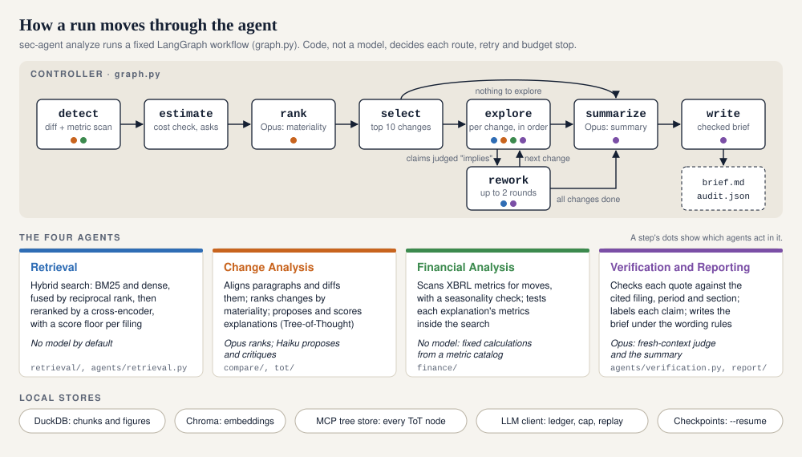

# SEC Filing Research Agent

A multi-agent system that compares a company's 10-K and 10-Q filings across reporting periods, finds material changes, tests competing explanations with Tree-of-Thought search, and writes a cited research brief for a fundamental analyst.

It is a first-pass research aid. It does not give investment advice, recommendations, or price predictions. Every explanation in a brief carries a verbatim quote from a filing. Only explanations that pass every check are labeled `confirmed`.

## Problem and user

The user is a fundamental equity analyst who follows a company through its SEC filings. Each quarter they need to know what changed since the last filing, which changes matter, and what the company says caused them. Today that means reading two long filings side by side, section by section. A careful reader still misses a reworded risk factor or a cause stated three sections away from the number it explains.

A single prompt to a language model is fast but unreliable here. It can quote the wrong period, attribute a cause the filing never states, or skip changes it doesn't find interesting. This agent splits the job into steps that code can check:
- code finds every changed paragraph and every metric move;
- a model ranks them by materiality;
- Tree-of-Thought search tests competing explanations against retrieved passages;
- only an explanation whose quote states the cause, in the right filing and period, is labeled `confirmed`.

Weaker explanations are labeled `plausible`, and anything left open is queued for the analyst to check.

## Documents

| Read | For |
|---|---|
| [docs/](docs/README.md) | The six design documents (Modules 1 to 6), with a summary of each, and an index of the notes below |
| [samples/](samples/README.md) | Nine real runs (three companies by three comparisons): read the briefs on GitHub, or browse them in the app with a light install |
| [src/sec_agent/](src/sec_agent/README.md) | How a run moves through the code: the workflow, the four agents, where each part lives, and what a run leaves on disk |
| [src/sec_agent/ingest/](src/sec_agent/ingest/README.md) | The corpus, how filings are validated, the figures loaded, and trying a new company |
| [src/sec_agent/ui/](src/sec_agent/ui/README.md) | The Streamlit app's five tabs |
| [eval/](eval/README.md) | Rerunning each evaluation, the benchmark, and the committed result files |
| [docs/EVALUATION.md](docs/EVALUATION.md) | What was measured, on which data, and the results |
| [docs/DESIGN_CHANGES.md](docs/DESIGN_CHANGES.md) | How the build fills the gaps in the original design, where it departs from it, and future enhancements |
| [docs/TASKS.md](docs/TASKS.md) | The build tasks that code comments cite by ID, such as "T4.4", and where each one's code is |

## How it works



`sec-agent analyze HSY --comparison yoy-10k` runs one comparison through a fixed LangGraph workflow. Code, not a model, decides the route:

1. **Detect.** Paragraphs are aligned section by section to find added, removed and modified text. A scan of XBRL metrics finds numeric moves. Sequential-quarter moves are compared with the same move a year earlier, to flag seasonality. No model is used.
2. **Estimate.** A cost estimate is printed, and the run asks before spending anything.
3. **Rank.** Claude Opus ranks the changes by materiality. The most material ones (10 by default) are explored, in order.
4. **Explore.** For each change:
   - Claude Haiku proposes explanations.
   - Local search finds evidence in both filings.
   - A Haiku critic scores each explanation, and code prunes the tree.
   - A fresh-context Opus judge sees only each claim and its quote.
   - Claims the judge finds only implied get up to two more rounds of searching.
5. **Write.** Opus writes the summary. The brief is checked against its rules before it is saved.

Each claim is labeled:
- **`confirmed`:** the quote is verbatim, from the right filing, period and section, and states the cause.
- **`plausible`:** supported, but not stated outright.
- **`unresolved`:** queued for human review in the brief, without pausing the run.

Causal wording, such as "due to" or "driven by", is only allowed in `confirmed` claims.

The design's four agents (Retrieval, Change Analysis, Financial Analysis, and Verification and Reporting) pass typed records through the graph, and every Tree-of-Thought node, score and pruned branch is kept in a local MCP tree store. [src/sec_agent/README.md](src/sec_agent/README.md) maps each step to its agent and code.

## Reviewing without running

Four ways to review the project, none of which needs an API key or ingestion:

1. **Read a sample brief.** [samples/](samples/README.md) holds nine real runs: three companies by three comparisons, each with its brief, full audit trail, model-call ledger and step timings. Start with [the Hershey 10-K brief](samples/runs/HSY-yoy-10k-t81-20261115/brief.md), which compares Hershey's FY2025 10-K with its FY2024 10-K. GitHub renders it directly.
2. **Browse the runs in the app.** The Streamlit app shows each run's brief, evidence trees, a step-by-step replay, the review queue and the cost and time. A light install of about 730 MB runs it on the samples in about 5 minutes; see [samples/README.md](samples/README.md#browse-the-runs-in-the-app-about-5-minutes-no-api-key).
3. **Check the evaluation.** [docs/EVALUATION.md](docs/EVALUATION.md) reports every result. The hand-checked benchmark is in [eval/benchmark/](eval/benchmark/README.md), the scripts are under [eval/](eval/), and the retrieval and judge result files are committed beside their scripts.
4. **Run the tests.** After the [setup](#setup) below (`uv sync --frozen` only), `uv run --frozen pytest` runs over 2,100 unit tests in about a minute. They need no network, no API key, no downloaded models and no ingested filings.

## Setup

Requires Python 3.12 and [uv](https://docs.astral.sh/uv/). No GPU or Docker is needed.

The first `index` and `analyze` download two local models from Hugging Face, about 0.5 GB in all:
- `BAAI/bge-base-en-v1.5` for embeddings;
- `cross-encoder/ms-marco-MiniLM-L-6-v2` for reranking.

```bash
pip install uv

uv sync --frozen
cp .env.example .env    # then fill in the two required values
uv run --frozen sec-agent doctor
```

uv creates the virtual environment as `.venv` inside the repo, which works on a normal local disk. The one exception is a repo on a VirtualBox shared folder, where symlinks and renames fail. There, keep the environment on local disk: run this before `uv sync` and add it to your shell profile.

```bash
export UV_PROJECT_ENVIRONMENT="$HOME/.venvs/sec-agent"
```

### Configuration

Two values in `.env` are required:

| Variable | Purpose |
|---|---|
| `ANTHROPIC_API_KEY` | Claude API key from the [Claude Console](https://platform.claude.com/). Billed separately from Claude subscriptions. |
| `SEC_USER_AGENT` | Your name and contact email. [EDGAR requires this](https://www.sec.gov/about/developer-resources) from automated clients. |

The optional settings are in [.env.example](.env.example):

| Variable | Default | Purpose |
|---|---|---|
| `SEC_AGENT_DATA_DIR` | `~/.local/share/sec-agent` | Where filings, the database, the index and runs are stored |
| `SEC_AGENT_MODEL_STRONG` | `claude-opus-5-5` | Materiality, the judge, and the brief |
| `SEC_AGENT_MODEL_WORKER` | `claude-haiku-5-5` | The Tree-of-Thought generator and critic |
| `SEC_AGENT_MAX_USD_PER_RUN` | `10` | Hard stop on model spend per run |
| `SEC_AGENT_LLM_CACHE` | `on` | Replays an identical model call from a local cache, at no cost |

## Quick start

These three commands take a fresh setup to a first brief. Only the last one costs money.

```bash
uv run --frozen sec-agent ingest     # download and validate the 15 pinned filings; safe to re-run
uv run --frozen sec-agent index      # chunk them and build the search index; safe to re-run
uv run --frozen sec-agent analyze HSY --comparison yoy-10k --max-changes 3
```

The pinned corpus ([config/corpus.yaml](config/corpus.yaml)) holds five filings each for Hershey (HSY), Mattel (MAT) and Stanley Black & Decker (SWK). `ingest` exits 1 if any filing fails validation. The first `index` takes about 15 minutes on a 4-core CPU; a re-run embeds only chunks that changed. [src/sec_agent/ingest/](src/sec_agent/ingest/README.md) covers the corpus, validation, the figures loaded, the commands for checking them, and trying a new company.

### Running an analysis

```bash
uv run --frozen sec-agent analyze TICKER --comparison yoy-10k|yoy-10q|seq-10q [options]
```

| Comparison | Filings compared |
|---|---|
| `yoy-10k` | The latest 10-K against the one before it |
| `yoy-10q` | The latest 10-Q against the same quarter a year earlier |
| `seq-10q` | The latest 10-Q against the quarter before it |

| Option | Effect |
|---|---|
| `--max-changes N` | Explore the N most material changes (default 10). The rest are listed in `audit.json`, not examined. |
| `--max-usd X` | Dollar cap for this run (default `SEC_AGENT_MAX_USD_PER_RUN`). A budget stop drops the least material changes first. |
| `--yes` | Print the estimate and go ahead without asking. |
| `--run-id ID` | Name the run (a fresh id by default). |
| `--resume ID` | Continue a stopped or killed run from its last finished change. Paid calls already made replay at no cost. |

**Cost and time.** The estimate printed before each run is the guide. Measured on 9 runs of 10 changes each, on a 4-core CPU:
- **Each change:** about $0.085 and 3.5 minutes, but up to $0.25 and 8 minutes. Three quarters of the time is waiting on model calls; the rest is local search.
- **A run with the default 10 changes:** $0.55 to $1.29 and 22 to 47 minutes.
- **The first run on a comparison** also pays for materiality: about $0.07 per batch of 20 changes, 6 to 22 batches per comparison. Later runs replay it from the cache at no cost.

The full measurements are in [docs/EVALUATION.md](docs/EVALUATION.md#cost-and-latency-t66-free-from-the-runs-above).

**Outputs** go to `<data dir>/runs/<run id>/`:

| File | Contents |
|---|---|
| `brief.md` | The research brief: a summary, then each finding with its labeled claims, quotes and figures, and the review queue |
| `audit.json` | Everything behind the brief: each claim's citations and check results, the judge's verdicts, and the changes not examined |
| `ledger.jsonl` | Every model call, with its tokens, cost, latency and the step it served |
| `timings.jsonl` | Wall time of every step and every local search |

[src/sec_agent/README.md](src/sec_agent/README.md#what-a-run-leaves-on-disk) lists everything else a run keeps, such as the Tree-of-Thought tree store and the checkpoints `--resume` reads.

### Browsing saved runs

```bash
uv run --frozen sec-agent app             # opens http://localhost:8501; --port to change it
```

A Streamlit app over the saved runs in `<data dir>/runs/`: each run's brief, evidence trees, a step-by-step replay, the review queue, and the cost and time. It calls no model, so browsing is free. It shows saved runs only; start runs with `sec-agent analyze`. [src/sec_agent/ui/](src/sec_agent/ui/README.md) describes the tabs.

To browse the committed sample runs instead: `SEC_AGENT_DATA_DIR=samples uv run --frozen sec-agent app`. Without a full setup, use the light install in [samples/README.md](samples/README.md).

## Evaluation

`sec-agent eval` reruns each evaluation against the hand-checked benchmark. Hershey is the tune split, the one settings were tuned on; Mattel and Stanley Black & Decker are the test split, run once.

```bash
uv run --frozen sec-agent eval tasks                  # list the commands, their task and cost
uv run --frozen sec-agent eval retrieval              # recall@5 (free, local models)
```

Paid commands require `--cap` and ask first. [eval/](eval/README.md) lists every command, its script and the committed result files, and [docs/EVALUATION.md](docs/EVALUATION.md) reports the results.

## Development

```bash
uv run --frozen pytest              # unit tests, with no network or paid calls
uv run --frozen pytest -m live      # paid smoke tests against the Claude API (under $0.01)
uv run --frozen pytest -m corpus    # validate all downloaded filings (run ingest first)
uv run --frozen ruff check src tests
uv run --frozen ruff format src tests
```

After changing dependencies, run `scripts/lock.sh` instead of `uv lock`, then `uv sync --frozen`. `uv lock` fails on VirtualBox shared folders with "Text file busy".

## License

[MIT](LICENSE).
