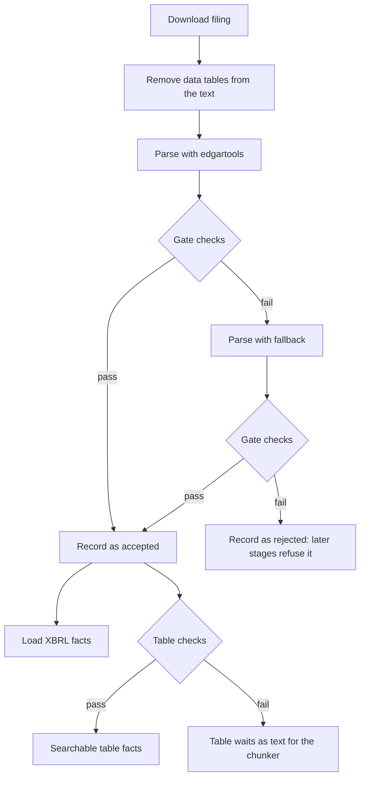

# How SEC Filing Ingestion Is Tested

Nov 4, 2026 · Joshua Gottlieb

## Summary

Ingestion turns SEC 10-K and 10-Q filings into clean text sections and searchable figures. Filing layouts vary, and parsing errors would reach every later stage without warning. So the system is tested in four layers.

| Layer | When it runs | What it does |
| --- | --- | --- |
| Gate checks | On every filing, during `sec-agent ingest` | Refuses a filing whose sections look wrong |
| Table checks | On every data table | Decides whether a table's figures can be trusted as facts |
| Automated tests | On demand, with `pytest` | Keep known behavior from breaking: 337 unit and 201 real-filing tests |
| Manual measurements | Before relying on a new rule set | Show how well the first three layers work on companies never seen before |

**The current state:** the latest fair test, on the current rules, accepted 17 of 25 unseen filings. None of the 17 had a materially wrong section (interval 0% to 20%). The 8 rejections look like false alarms, so they cost coverage and not accuracy. Acceptance still doesn't prove a filing is right: an earlier test accepted 4 filings with wrong sections.

## The route a filing takes

Every filing passes the same checks, and a second parser gets a chance before a filing is rejected. Only an accepted filing's figures can load.

The fallback parser finds sections independently, using item headings or a cross-reference index. A filing's XBRL facts load once it's accepted, and table figures join them only after the table checks.

## Gate checks on every filing

A filing must pass every check below to be accepted. Each one catches a specific failure, and each has a limit that a real filing has exposed.

| Check | What it catches | Real example | Its limit |
| --- | --- | --- | --- |
| Required sections are present and long enough | A parser returning a fragment | `edgartools` gave AT&T's Q3 2026 10-Q an MD&A of 5,066 characters, under the 10,000 minimum, so the fallback took over | Length doesn't show a section is right. Everus's notes passed at about 100,000 characters with their ending missing |
| A long section opens with its title | A section starting in the wrong place | Sections of 1,200 characters or fewer are exempt, after Cosmos Health's "Not applicable" sections failed wrongly | It looks only at the opening |
| A section contains its expected terms | The wrong text under a section's name | AT&T's short MD&A from `edgartools` had none of its expected terms | A swollen section still contains them |
| No headings from another part of the filing | One section running into another | Chevron's MD&A ran on through the financial statements, though every length looked fine | It knows only listed headings, so other misfiled text gets through |
| 90% of sampled sentences reach a parsed item | Dropped or truncated text | `edgartools` reached 66% to 71% on AT&T's 10-Qs | Signatures count as parsed, so Everus's notes filed there went unnoticed |
| No sentence is lost when tables are removed | Removing text along with figures | United Bancshares has a sentence inside a row label, dropped with its figures | It checks only sentences of 15 words or more |
| No data tables remain in the text | Tables that should have been removed | Comstock's share issuance tables | It relies on XBRL tags in the table, so untagged tables can slip by |
| No paragraph is mostly numbers | Table rows flattened into prose | National Vision's long balance-sheet row. It takes 8 numbers making up 40% of the words | Other noise gets through, such as Western Digital's "(Continued)" headers |

Two more checks look at where a section ends, after Everus's 10-Ks passed everything above with their last notes missing.

| Check | What it catches | Real example | Its limit |
| --- | --- | --- | --- |
| Note numbers run complete | Notes missing from the section | Everus's notes stop at 11 but cite Note 15 | It can't read lettered notes, as with Stanley |
| No more than 2,000 characters of prose before the next item, unless parsed elsewhere | A section that stops early | About 21,700 characters in Everus's 10-Ks, and at most 296 anywhere else | It needs the expected next heading, and it misses smaller losses |

**If a filing fails,** it's recorded as rejected, and later stages refuse that record. A rejected filing or an outdated record can't reach the fact store or the index.

## Table checks on every data table

A table's figures become searchable only if every part of the table can be explained. Otherwise the whole table waits as text for the chunker, so no figure becomes unreachable. Only about 19% to 35% of data tables pass today.

| The table must have | Why | Error this rule came from |
| --- | --- | --- |
| One stated scale, with evidence of dollars or percent | A figure read at the wrong scale is off by a factor of 1,000 | Apple's caption scale, "$23 trillion" from a table mixing two scales, and AT&T's "(in 000s)" subscribers |
| A current or past period on every column of figures | A figure without a date can't be compared | A future-dated column |
| No share, per-share or non-dollar rows | Those aren't dollars | Employees and Chevron's barrels read as dollars |
| No text beside the figures, or a second header inside | The columns may not mean what they seem to | A hypothetical "Term debt" row, and second headers mid-table |
| No disagreement with any XBRL tags in the table | Tagged cells act as an answer key | MKS's "Percentage" column read as dollars |

**A recent fix:** AT&T's Q3 2025 10-Q labels subscriber tables "(in 000s)". The parser used the page's "Dollars in millions" instead, so 90,255 thousand subscribers were stored as $90 billion. It now reads shorthand such as 000s, $000, (000,000) and MM as a scale, and these tables wait as text because they state no dollars. Across 6,620 tables, exactly 3 stopped producing facts, which removed the 22 wrong ones. The tag check can't confirm this, since those cells have no tags.

## Automated tests

The automated tests pass today: 337 unit tests and 201 real-filing tests. They stop known behavior from breaking, but they can't reveal problems on companies they've never seen.

| Suite | Command | Tests | What it covers |
| --- | --- | --- | --- |
| Unit | `pytest` | 337 | Rules on small examples, with no network. Table rules, gate checks, fallback layouts, section cleanup, routing, the fact store, XBRL reading, the EDGAR client and fiscal periods |
| Real filings | `pytest -m corpus` | 201 | The behavior of 140 downloaded filings |
| Live | `pytest -m live` | 3 | Calls to Claude only, so these don't test ingestion |

The real-filing suite checks that:

- each of the 140 filings gets its expected gate result: 123 pass, and 17 are known rejections
- a known rejection that starts passing fails the test, so someone has to read its sections
- known passages land in the right section, and the analysis companies' notes run through their last note
- fiscal labels match the derived calendar
- at least 99% of tagged table cells parse correctly
- loaded XBRL facts match the SEC's own API
- no percent column is stored as dollars

A passing suite doesn't mean those 123 filings are correct, because it mostly pins the gate's decision. Everus's and AT&T's wrong sections passed this suite until the checks changed.

## Manual measurements

Manual measurements test the tests. A person has to read their output, so they aren't part of `pytest`. The scripts are in `eval/ingestion/`, and its README gives the full procedure.

A **held-out test** is the main measurement. It draws five unseen companies at random with a new seed, then fingerprints the rule files to prove they didn't change during the test. Everything found is written up before any rule is fixed. Once those filings have shaped a fix, they no longer give a fair rate.

| Measurement | Script | What it answers | Its limit |
| --- | --- | --- | --- |
| Boundary reading | `read_boundaries.py` | Does each section start and end in the right place? | It shows only the first and last paragraphs |
| Parser comparison | `compare_parsers.py` | Do the two parsers agree, sentence by sentence? | A shared error looks like agreement, as with AT&T's market risk |
| Tagged-cell answer key | `table_accuracy.py` | Do parsed values and dates match XBRL tags? | It overstates accuracy, because tagged tables are the easiest ones |
| Cross-filing agreement | `cross_filing_agreement.py` | Do two filings report one untagged figure the same way? | Disagreements can be real restatements, so each needs tracing |
| Hand audit | `audit_sample.py` | Are sampled untagged facts right against the raw table? | Samples are small |
| Store checks | `store_checks.py` | Are known error shapes in the database? | It finds only shapes already known |
| Fiscal labels | `fiscal_check.py` | Do derived periods match filers' tags? | Each difference must be read to see which side is right |

The other scripts support these: `draw_companies.py`, `fingerprint.py` and `intervals.py`.

## Results

Four fair tests show no steady rise in acceptance, and the third showed that the gate can accept wrong sections. Each test used five new companies and 25 filings, and the rules changed between tests. Only the fourth describes the current rules.

| Measure | First (Nov 3) | Second (Nov 3) | Third (Nov 4) | Fourth (Nov 4) |
| --- | --- | --- | --- | --- |
| Companies | Avnet, Albemarle, National Vision, CVD Equipment, Flexsteel | Western Digital, United Bancshares, MKS, Cosmos Health, Ingram Micro | RxSight, Comstock, Autoscope, Everus, AT&T | Jabil, CapForce, United Natural Foods, First America Resources, Regis |
| Filings accepted | 18 of 25 (72%) | 17 of 25 (68%) | 24 of 25 (96%) | 17 of 25 (68%) |
| 95% interval | 51% to 88% | 46% to 85% | 80% to 100% | 46% to 85% |
| Accepted with a materially wrong section | 0 of 18 | 0 of 17 | 4 of 24 | 0 of 17 |
| Filings using the fallback | 14 of 25 | 7 of 25, on current rules | 3 of 25 | 11 of 25 tried it, and 3 passed with it |
| Tagged cells correct, measured blind | 99.23% of 4,940 | 99.44% of 3,039 | 100% of 2,441 | 100% of 2,938 |
| Hand audit of untagged facts | 40 of 40 numbers, not blind | 36 of 36 values | 35 of 36 | 27 of 27 |

How to read these results:

- **Acceptance moves with the draw.** It fell from 96% to 68% even though the rules improved. The intervals overlap, and filings from one company resemble each other.
- **The best single number is 17 of 25 (68%, interval 46% to 85%).** That's the share of the fourth test's filings that were both accepted and free of material error, and it's the only fair number for the current rules.
- **The largest cost is now false rejection.** All 8 rejections in the fourth test look like false alarms. CapForce's 3 come from a row label that reads as a sentence. First America Resources' 5 come from length minimums set for much larger companies.
- **The gate can fail unsafely.** Everus's 10-Ks lost about 100 sentences of notes, including the segment note. AT&T's 10-Ks filed about 15,000 characters of audit and management reports under market risk. New checks now catch both. The fourth test found no new case, but its interval runs to 20%.
- **Across all four tests,** 4 of 76 accepted filings had a wrong section (interval 2% to 13%). All 4 come from two companies, so this figure is rough.
- **Table values have held up.** The latest audit found 27 of 27 right. The one wrong fact before it was the AT&T subscriber count, now fixed. No clean table in the latest draw uses shorthand scales, so new data hasn't tested that fix.

The method and every traced finding are in `eval/parser_holdout.md`.

## What each check contributes

Every remaining gate check either changes a result or backs up another check. `check_matrix.py` runs each check on both parsers' output, for 280 parses of the 140 filings.

| Check | Fails on `edgartools` | Fails on fallback | Only failure on a parse | Filings rerouted if removed |
| --- | --- | --- | --- | --- |
| Required section length | 21 | 14 | 12 | 11 |
| Opens with its title | 11 | 0 | 4 | 4 |
| Expected terms | 4 | 2 | 0 | 0 |
| Another part's heading | 8 | 5 | 8 | 6 |
| Sentence coverage | 4 | 3 | 0 | 0 |
| Lost table sentence | 6 | 6 | 10 | 6 |
| Leftover table | 1 | 1 | 1 | 1 |
| Numeric paragraph | 8 | 3 | 10 | 8 |
| Note numbering | 2 | 1 | 0 | 0 |
| Section ending | 2 | 0 | 0 | 0 |

A zero in the last column doesn't make a check removable by itself. Removing length and coverage together reroutes 13 filings, against 11 for length alone, and also removing expected terms reroutes 17. Removing note numbering and the ending check together reroutes Everus's 2 10-Ks.

**Two checks were removed,** because doing so changed no result on the 115 filings tested at the time. The check for a short item holding main content never failed in 230 parses. The signatures check fired only where numbering and the ending check also fired. No check now looks directly for a long item that absorbs MD&A, or for a small misfiling under signatures on a filer without numbered notes.

**The fallback runs on about a third of filings.** It ran on 47 of 140, and on 36 of the 100 randomly drawn filings (36%, interval 27% to 46%). It succeeded on 19 of those 36, and both parsers failed on the other 17. It ran on about half of 10-Ks (19 of 40) and over a quarter of 10-Qs (17 of 60). On the fair fourth test alone, it ran on 11 of 25 and succeeded on 3. `edgartools` never crashed, so every call came from a failed check.

## Known gaps

These problems are known and not fixed. Each one found so far either rejects a filing or adds noise, so the main cost is coverage. Most rejections below are of filings that look usable.

| Problem | Effect | Filings seen | Effect on later stages |
| --- | --- | --- | --- |
| Reports between Item 7A and Item 8 land in market risk | Both parsers misfile them, so the filing can't be used | AT&T 10-Ks (2) | Rejected |
| Exhibit 13 isn't read | MD&A and statements are out of reach | United Bancshares 10-Ks (2) | Rejected |
| A sentence inside a row label is lost | The gate rejects a usable filing | United Bancshares 10-Qs (3), CapForce 10-Ks (2) and 10-Q (1) | Rejected |
| Length minimums don't fit very small companies | The gate rejects usable filings | First America Resources (5) | Rejected |
| The fallback can't find Item 1 without a heading in the body | Notes are lost | Cosmos Health Q2 2025 10-Q (1) | Rejected |
| Tables with one number column stay in the text | The gate rejects a usable filing | Comstock 2024 10-K (1) | Rejected |
| Running headers stay in the notes | Noise, and sentences split across page breaks | Hershey (42 of 309 paragraphs in its FY2025 10-K), Western Digital, Regis 10-Ks | Minor |
| Rule lines are read as headings | 83 to 117 paragraphs per filing get a heading of underscores | Regis (5) | Minor |
| Page banners and table-of-contents lines remain at section edges | Noise at the edges | AT&T and Albemarle 10-Qs | Minor |
| Text just outside the notes is kept with them | A forward-looking statement or a document list at the section's edge | Jabil 10-Qs (3) and 10-Ks (2) | Minor |
| "No new risk factors" and "not required" aren't labeled as no change | A no-change result looks like content | Comstock 10-Qs (3), CapForce 10-Qs (2) | Minor |
| Most data tables wait as text | Those figures need the chunker | Comstock and CapForce have no table facts at all | Reachable later |

The tests themselves also have limits:

- **Middle-of-section errors:** people read only each section's first and last paragraphs. Only the parser comparison looks further, and it can't see shared errors.
- **Untagged figures:** only small hand audits check them directly.
- **Stale companies:** a draw can pick a company that no longer files. Autoscope's filings here end in 2022.
- **No fair rate after a fix:** fixing any problem above makes these rates historical. Another draw would be needed to measure the new rules.
